# ThermoTrace

<p align="center">
<pre>
 _____ _                             _____                   
|_   _| |__   ___ _ __ _ __ ___   __|_   _| __ __ _  ___ ___ 
  | | | '_ \ / _ \ '__| '_ ` _ \ / _ \| || '__/ _` |/ __/ _ \
  | | | | | |  __/ |  | | | | | | (_) | || | | (_| | (_|  __/
  |_| |_| |_|\___|_|  |_| |_| |_|\___/|_||_|  \__,_|\___\___|
</pre>
</p>

<p align="center">
  
  
  
  
  
  
  
  
  
  
  
  
  
  
  
  
  
  
  
</p>

# ThermoTrace - India industrial intelligence + thermal-source classification

ThermoTrace is a Web GIS that does two things on one map:

1. **Industrial sites** - industrial facilities mapped in OpenStreetMap, stored in PostGIS and kept in sync by a background worker (state/district assignment, filters, search, exports, live updates).
2. **Thermal sources** - NASA FIRMS (VIIRS 375 m) heat detections grouped into persistent *sources* and classified as **industrial vs. agricultural vs. forest fire**, using the facility map and ESA WorldCover land cover, with a plain-language explanation for every decision.

> FIRMS shows *where heat was seen*, not *why*. ThermoTrace scores competing explanations from physical evidence (persistence, night activity, radiative power, footprint, nearby facility, land cover, season). The weights are **expert-set priors, not trained on labelled ground truth**, and the output is a decision-support hint to be confirmed with imagery - never an official determination.

---

## Dashboard

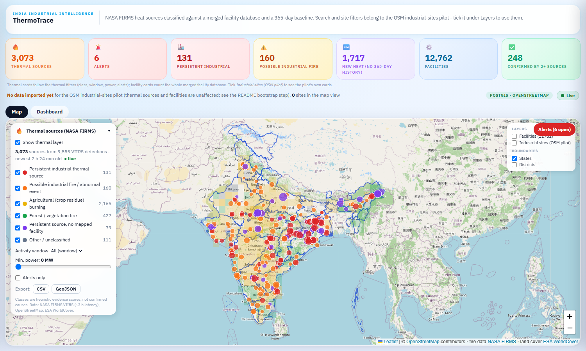

_National view (2026-10-16, 3,073 sources): below zoom 8 the crop and forest fires are a heat-density grid (cell colour = dominant class, opacity = how many sources) and only industrial sources, alerting sources and the selected one stay as points; from zoom 8 every source is a point. Facilities are a separate toggle and start off._


_Dashboard captured 2026-10-15 from the Docker stack (PostGIS, API, thermal worker, frontend): 2,757 classified FIRMS thermal sources from 7,807 VIIRS detections, status "live" (newest detection about 3 h old), over the 12,762-facility layer (small dots; blue = confirmed by two or more sources). Filled circles are thermal sources (size = radiative power, colour = class, dark ring = alert). The left panel filters by class, window, minimum power and alerts and exports CSV/GeoJSON; the top-right box toggles the facility layer (with the source attributions), the OSM north-east pilot layer and the boundaries. The site cards read 0 because the optional OSM north-east pilot import was not run on this fresh database; the header says so instead of covering the map._


_Clicking a facility shows where it comes from. Tirora TPP (3,300 MW, coal) is one facility built from six OpenStreetMap records and one WRI Global Power Plant Database record, each listed with its source id, distance to the anchor and licence; the blue outline is the OpenStreetMap footprint of the plant._

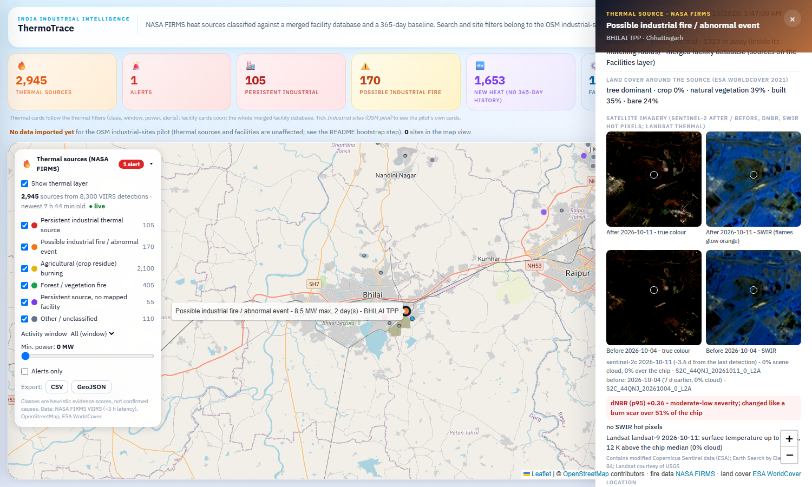

_Clicking a thermal source shows Sentinel-2 L2A chips (3 x 3 km, true colour and SWIR B12/B11/B8A) from the clearest scene within 5 days of the detection and a before scene from the same tile 2-40 days earlier, with scene id and cloud %, the dNBR burn index, the SWIR hot-pixel count and a Landsat 8/9 surface-temperature check. Here: Bhilai steel plant, dNBR p95 +0.36 over 51 % of the chip, no SWIR hot pixels, Landsat 12 K above the chip median._

## Findings

All figures are produced by `industrial-data/scripts/make_figures.py` from the real result files. Read the caveats: labels are weak and rule-derived, incident locations are partly coarse, and one snapshot of one week is not a trend.

**1. The trained model beats the rules on held-out regions and months - against rule-derived labels.** On `labels-v1` (test = held-out states AND windows from 2026-04-01, 1,021 units) the gradient-boosted model reaches macro-F1 **0.993** (95 % CI 0.987-0.998) against **0.809** (0.763-0.848) for the rules. The rules' weak point is persistent industrial heat: recall 0.30 (they call it "fire candidate"), the model 1.00. Full report: [docs/EVALUATION.md](docs/EVALUATION.md).

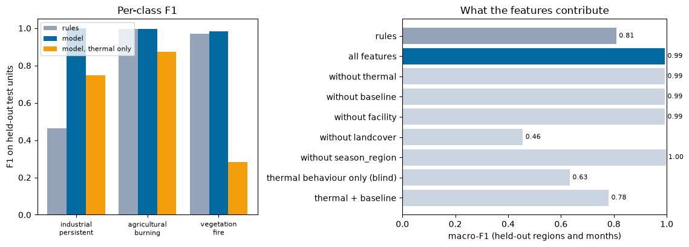
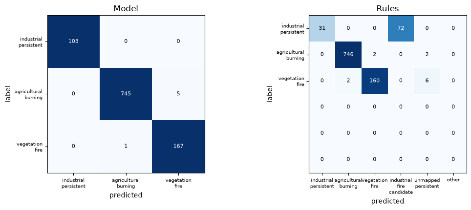

**2. Context, not satellite behaviour alone, separates the classes.** A model that sees only thermal behaviour (persistence, night share, power, footprint) scores macro-F1 0.633, below the rules; facility proximity and land cover carry the rest. Since those same inputs define the labels, 0.993 is agreement with the labelling rules, not real-world accuracy. The independent check is the 34 verified incidents: VIIRS saw heat inside the incident circle for 20 of them; at 0.25 false alarms per day (held-out crop/forest units) the model flags all 20 and the rules 16 (80 %); the other 14 produced no detection at all, which no thermal method can recover. The model scores worst where the location is only a named locality (5 detected: 4 above 0.5).

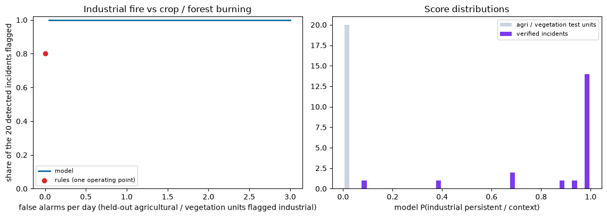

**3. Radiative power does not separate industrial from agricultural fires.** Median peak power per source is 3.1 MW for persistent industrial, 3.2 MW for crop burning and 3.4 MW for vegetation fire; night share and persistence do the separating (median night share 1.0 for the industrial classes, 0.0 for crop and forest fires).


**4. Persistent "industrial" heat in this pilot is mostly coal.** Of 152 persistent industrial sources in the 2026-10-02 to 2026-10-08 run, 86 sit on OSM mining/quarry features and 42 on thermal power plants (only 2 refineries, 2 steel plants, 3 cement works). By state: Jharkhand 33, Odisha 28, Chhattisgarh 16, Maharashtra 14, Rajasthan 10. Burning coal seams and overburden dumps are a heat source a facility list alone would not explain.

**5. Satellite evidence for documented incidents is thin and depends on where the incident sits.** 34 of the 40 documented industrial fires are verified (source text confirms event, place and date; location resolved to an OSM object: 12 at the plant itself, 11 in an industrial estate, 11 at a named locality). Against VIIRS S-NPP + NOAA-20: 13 show a detection above the place's own baseline, 7 sit on a site that is routinely hot (a refinery fire is not separable from baseline at 375 m), 14 show nothing. Of the 12 plant-level incidents 11 have a detection in the event window, but only 5 are above baseline and 6 are indistinguishable from routine heat; 13 of the 14 "no detection" cases are estate- or locality-level, where the heat source is a single small unit inside a 2-3 km circle. The two strongest signals are Vatva GIDC (62 MW) and Igatpuri / Jindal Poly Films (54 MW).


**6. Satellite imagery confirms burn scars, not industrial building fires.** dNBR (Sentinel-2, before vs after) is high for crop and forest burning (median p95 0.38 and 0.34 on a 180-unit sample) and low for persistent industrial sites (0.17); a fire inside a plant is too small and too short to leave a 10-20 m burn scar (Vatva GIDC, 62 MW on VIIRS: dNBR 0.02). Crop dNBR also includes harvest, which lowers NBR without any fire. SWIR hot pixels behave the other way (median 94 per chip at industrial sites, 13 crop, 0 forest), but most of those are furnaces, flares and coal seams, i.e. routine heat. As model features they add nothing to the full model (grouped 5-fold CV macro-F1 0.994 with and without) and +0.06 to the thermal-only model (0.484 to 0.547) on 180 units without confidence intervals, so the live model does **not** use them: imagery is computed for a few candidates per cycle only, and a feature missing for most sources would skew training against serving. They are shown as evidence and reasons. Script: `industrial-data/scripts/imagery_feature_experiment.py`.

**7. Honest limits of the numbers.** Rule-derived labels; incidents are a small sample (single digits per location tier); the threshold in the incident table is a near-zero probability because calibrated P(industrial) for crop/forest units is essentially zero; "industrial fire candidate" means an episodic detection at a facility, not a confirmed fire.

Regenerate: `python industrial-data/scripts/evaluate.py [--refresh-features] && python industrial-data/scripts/make_figures.py` (matplotlib is only needed for the figures); screenshots come from `industrial-data/scripts/capture_dashboard.py` against the Vite dev server (`npm run dev`) with the API running.

## Project status

| Phase | Scope | State |
|---|---|---|
| 0 | Clean foundation: legacy tests green, thermal layer is the default map, honest README badges | **done** |
| 1 | Facility database with provenance: OSM + WRI GPPD + GEM + VIIRS Nightfire, PostGIS, API, map layer | **OSM + WRI + VIIRS Nightfire flare sites done; GEM not loaded** (form behind a Cloudflare bot check, must be submitted by a person) |
| 2 | 12-month FIRMS baseline per facility and per 1 km cell (S-NPP + NOAA-20), z-score of today against it, shown for every source | **done** (see [Baseline](#baseline-what-is-normal-for-this-place)) |
| 3 | Labelled evaluation set: 3,247 weak rule labels (3 classes) + 32 verified incidents, region/time split, checksummed manifest | **done** with two documented deviations (no MCD64A1 confirmation, no GEM) - see [Labelled evaluation set](#labelled-evaluation-set) |
| 4 | Trained model (gradient-boosted trees, calibrated, Shapley reasons, `model_version`) in the live pipeline, rules kept as baseline/fallback, `docs/EVALUATION.md`, `/api/thermal/model` | **done**: model beats rules on held-out data (0.993 vs 0.809 macro-F1, against rule-derived labels); incident check on all 34 verified incidents (20 with a detection) |
| 5 | Sentinel-2 L2A after/before chips (true colour + SWIR), dNBR, SWIR hot pixels, Landsat 8/9 TIRS check, cached, `/api/thermal/sources/{id}/imagery`, dNBR in the reasons | **done**; imagery tested as model features and **not** adopted (see Finding 6) |
| 6 | Industrial-fire alerting (rule, severity, dedupe per facility per 6 h), webhook + Telegram + email delivery, analyst inbox (Confirm / Reject / Unsure + note) writing to `labels`, incident timeline | **done**; delivery verified against a local fake Telegram server, **not yet against a real bot** (needs your `TELEGRAM_BOT_TOKEN`) - see [Alerting](#alerting-and-the-analyst-loop) |
| 7 | Replay mode: archived FIRMS for documented incidents through the live pipeline on a virtual clock; demo video | **done**: 3 incidents + a gas flare + a Punjab burning day, all as expected, recorded in [the demo video](docs/demo/thermotrace_replay_demo.mp4); but only **5 of the 22 detected verified incidents** alert (see [docs/REPLAY.md](docs/REPLAY.md)) |
| 8 | Judge-facing product: zoom-dependent map, dashboard tab, PDF incident report, hosted demo, video + deck | **done except hosting**: map, dashboard, PDF report, 2-minute video and 6-slide deck are built and tested; the one-VM demo (Caddy HTTPS, read-only user, rate limits) is **ready and checked locally but not deployed** - no VM or domain - see [Judge-facing product](#judge-facing-product) |
| 9 | remaining items | planned - see [docs/IMPLEMENTATION_PLAN.md](docs/IMPLEMENTATION_PLAN.md) |

## Baseline: what is normal for this place

A persistent flare, kiln or coal-seam fire is normal for its place; a new fire is not. Seven days of FIRMS cannot
tell them apart, so every thermal source is compared with **365 days of the same place** (VIIRS S-NPP + NOAA-20
from the FIRMS archive: standard-processing data through 2026-06-30, near-real-time after that).


_Source detail panel (captured 2026-10-15 from the Docker stack): Bhubhaneshwari coal mine (Odisha) is normally active on 78% of days at this facility over 365 covered days, typical detection 2.5 MW (95th percentile 6.9 MW), 82% of detections at night; its latest day summed 76.9 MW, z = +1.1 against its own daily history, so "within its usual range" - a routine coal-mine fire, not a new event. The bars are the share of active days per month (current month highlighted)._

| Definition | Value |
|---|---|
| Window | 365 days ending 14 days before the newest detection (2025-10-01 .. 2026-09-30 for the 2026-10-14 run), so the live window is not part of its own baseline |
| Entities | **facility** (a detection belongs to the facility whose radius + 500 m contains it with the largest margin) and **1 km cell** (EPSG:6933 equal-area grid) |
| Covered day | a window day on which the archive holds any detection - archive gaps are not counted as quiet days |
| Detections used | low-confidence pixels dropped; one physical detection held as both SP and NRT counted once (SP wins) |
| Per entity | active-day fraction, 12-month active profile, median and 95th-percentile FRP, night share, mean/std of daily FRP (inactive days = 0) |
| z-score | `(FRP today - daily mean) / max(daily std, 1 MW)`; "today" = the entity's latest day in the live window, summed over every detection of that entity |
| "Never seen" | an entity with no detection in the window is reported as new heat (0% of days), not as a routine source |

Where it lives: `sql/migrations/006_thermal_baseline.sql` (materialised view `thermal_baseline`, `thermal_detection_geo`,
`assign_thermal_geo()`, `product`/`satellite`/`acq_date` columns on `thermal_detections`), `src/thermal/baseline.py`
(the same numbers computed with pandas for the no-database mode; `tests/sync/test_baseline_postgis.py` checks that the
SQL view and the pandas code agree entity by entity).

```bash
python -m src.thermal.baseline download --start 2025-10-01 --family SNPP --family NOAA20 --out ../data/archive   # needs FIRMS_MAP_KEY
python -m src.thermal.baseline report  --archive ../data/archive/snpp --archive ../data/archive/noaa20   # gaps, products
python -m src.thermal.baseline load    --archive ../data/archive/snpp --archive ../data/archive/noaa20   # -> PostGIS + view
python -m src.thermal.baseline compute --archive ../data/archive/snpp --archive ../data/archive/noaa20   # file mode (parquet)
```

Loading the archive into PostGIS (`baseline load`, local Docker stack, 2026-10-15): 1,874,454 detections inserted, each assigned to its facility and 1 km cell, and the view built in 710 s: 651,831 baseline rows, 4,993 of them facilities (the pandas build gives 651,824; the few-entity difference is the facility search: PostGIS checks every facility within 6.5 km, the pandas twin the 8 nearest).

Live Docker worker, 2026-10-15: every one of the 2,757 current sources carries the baseline fields from the PostGIS view; 1,231 have history at their place, and the 102 persistent industrial sources are normally active on a median 58 % of days.

Result on the 2026-10-14 run (5,418 current sources, 365 covered days, 651,824 baseline entities from 1.88 million archive detections):

* 2,046 sources have history at their place, 3,372 do not (new heat for that cell: 2,725 of them are crop burning, 521 vegetation fire).
* Persistent industrial sources are the routine ones: 187 of 188 have history, normally active on a median **42 % of days** (not ~100 %: cloud and monsoon hide a true 24/7 source from a 375 m sensor on many days). Crop-burning sources with a history are active on a median 0.3 % of days.
* z-score: 1,310 sources are within their usual range or below (< 2), 2,209 are elevated (2 to 4), 1,866 are far above (>= 4) - almost all of the latter are fires in places with no history, where the 1 MW std floor makes any detection a large z.

### Verification of phases 0-2 (2026-10-15, Docker stack on this machine)


| Phase | Item | Result | Evidence |
|---|---|---|---|
| 0 | Frontend Docker build | **pass** | `docker compose build frontend` built; the nginx image serves the UI and proxies `/api` on :8080 (screenshot above). nginx now re-resolves the API container, so recreating it no longer leaves a 502 |
| 0 | CI green | **pass** | the GitHub Actions runs for the last six pushes to `main` finished with `success` (API, PostGIS and frontend jobs) |
| 0 | PostGIS API suite | **pass** | 34 passed, 0 failed (`backend/tests/postgis`, throw-away database) |
| 0 | Legacy pipeline tests | **pass** | `industrial-data/tests`: 297 passed, 0 skipped with PostGIS available |
| 0 | Facilities in PostGIS, matching reads them | **pass** | table `facilities`; the Docker worker (`THERMAL_SITES_FROM_DB=1`) loads 12,762 rows from it. The GeoJSON file remains a fallback for the no-database mode only |
| 0 | OSM pilot layer behind a toggle | **pass** | off by default, map shows thermal sources + facilities |
| 0 | Badges match the code | **pass** | Redis, Celery, MapLibre, Plotly, SciPy removed |
| 1 | OSM + WRI in PostGIS with provenance | **pass** | 19,497 OSM + 397 WRI records -> part of 12,762 facilities in `facilities`, every record in `facility_sources` with source id, licence, attribution; 248 facilities confirmed by two sources; 580 OSM outlines |
| 1 | Global Energy Monitor trackers | **not done** | loader and tests exist (fixtures). The GEM download form was filled with the owner's details and consent, but it is protected by a Cloudflare Turnstile bot check that only a person can complete; the files have not been downloaded |
| 1 | VIIRS Nightfire flare sites | **pass** | 196 Indian flare sites from the World Bank GFMR "Flare Volume Estimates by Individual Flare Location 2012-2025" (VIIRS Nightfire detections processed by the Earth Observation Group; open, CC BY 4.0, no account needed); gas-flare facilities 17 -> 213. The raw EOG VNF files (account required) are not needed for this |
| 1 | Facilities layer with source attribution | **pass** | `/api/facilities` (PostGIS) + map layer, attribution list and per-record licences in the popup |
| 2 | 12 months of S-NPP + NOAA-20, `product` column | **pass** | 1,874,454 detections (SP 1,815,205, NRT 62,066) in `thermal_detections`; 365 covered days |
| 2 | `thermal_baseline` view | **pass** | 651,982 rows (facility and 1 km cell) with active-day fraction, 12-month profile, median/p95 FRP, night share; rebuilt automatically when the facility table changes (facility ids can move to a new anchor) |
| 2 | Every current source: "normally active X% of days, typical FRP Y MW" + z-score | **pass** | of 2,889 current sources, 2,889 have the active-day fraction and a z-score; 1,274 have history at their place (typical FRP shown), the other 1,615 are "never seen here" |

Phase 1 is therefore complete for three of the four sources (OSM, WRI, VIIRS Nightfire flare sites) and **incomplete for
GEM**: its download form ends in a bot check that only a person can pass. Drop the GEM files into `data/facilities/raw/`
and run `docker compose --profile bootstrap run --rm facilities` to finish it.

## Labelled evaluation set

Without labels there is no accuracy number. `labels-v1` (full rules, split, leakage policy and deviations in
[docs/LABELS.md](docs/LABELS.md)) holds **3,281 labels**: one label is a 1 km cell x 7-day window with at least one
VIIRS detection, or one verified incident.

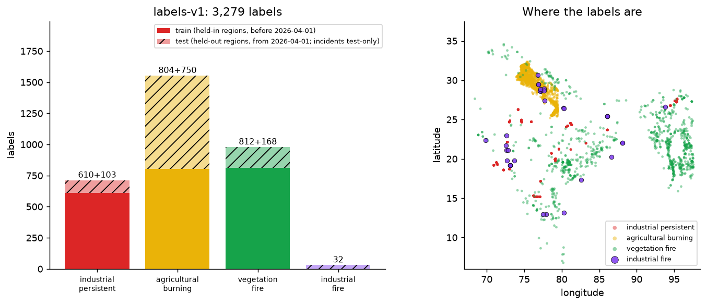

| Class | Rule (short) | Train | Test |
|---|---|---|---|
| `industrial_persistent` | within 1 km of a WRI / flare-site facility that was active on >= 20 % of 365 days | 610 | 103 |
| `agricultural_burning` | WorldCover cropland >= 70 %, Punjab / Haryana / west UP, Oct-Nov or Apr-May, no facility within 3 km, episodic | 804 | 750 |
| `vegetation_fire` | WorldCover tree + shrub >= 70 %, no facility within 3 km, episodic | 812 | 168 |
| `industrial_fire` | verified documented incident (source text + OSM location) | - | 34 |

* **Split by region and by time, never random:** train = held-in regions before 2026-04-01; test = held-out regions
  (Andhra Pradesh, Chhattisgarh, Maharashtra, Punjab) from 2026-04-01. Incidents are test-only.
* **Evidence per label:** source URL, rule inputs and values (`detail`), who/what labelled it; incidents carry the
  source's sha256 and their NASA FIRMS result. Stored in PostGIS (`labels`, migration 007) and as parquet / csv.gz with
  `manifest_v1.json` (sha256 of every file, inputs, parameters): `python -m src.labels.cli verify`.
* **Leakage:** the weak rules read the same things a classifier reads (facility proximity, land cover, season, 365-day
  activity). A score on those three classes measures agreement with the rules; report it next to a model that is
  blind to the rule inputs. The 34 incidents are the only labels independent of them.
* **Not met as planned:** vegetation fires are not confirmed by MODIS MCD64A1 burned area (needs an Earthdata login);
  Global Energy Monitor trackers are not loaded, so `industrial_persistent` rests on 36 power-plant and flare-site
  facilities; `industrial_persistent` test support is 103 windows and `agricultural_burning` test is one state.

```bash
cd industrial-data
python scripts/incident_evidence_fetch.py     # (repo root) fetch each incident's source page
python scripts/incident_evidence_check.py     # does the text name event, place and date?
python scripts/build_incidents_verified.py      # source checks + curated locations -> data_labels/incidents_verified.csv
python -m src.labels.cli build --postgis        # -> data/labels, data_labels/labels_v1, PostGIS table `labels`
python -m src.labels.cli verify
```

## What is implemented (and verified)

| Area | Status |
|---|---|
| FIRMS ingestion (S-NPP, NOAA-20, NOAA-21 VIIRS NRT; public CSV or `MAP_KEY` API) | working, run against real data |
| Clustering into thermal sources, facility matching, land-cover sampling, explainable classifier | working, 24 unit tests |
| Thermal layer on the map, class filters, alert flag, source detail panel with reasons + detection timeline, Sentinel-2 after/before chips + dNBR + SWIR hot pixels + Landsat thermal (`/api/thermal/sources/{id}/imagery`), CSV/GeoJSON export | working (frontend tests + browser check of the map layer) |
| Snapshot **and** PostGIS storage (`thermal_sources`, `thermal_detections`, `thermal_runs`) | PostGIS path run against a real PostGIS container |
| OSM industrial sites: baseline import + incremental replication (osm2pgsql) with durable checkpoint, locking, backoff, revisions | 23 lifecycle tests; baseline imported (below); catching up to the live diff feed **not observed to completion** |
| Merged facility database (OSM 19,497 records + WRI GPPD 397 plants + 196 World Bank / VIIRS Nightfire flare sites -> 12,762 facilities, 248 confirmed by two sources, 580 with OSM footprints) with per-record source id, licence and attribution; `facilities` / `facility_sources` tables, `/api/facilities` (PostGIS or files), map layer with provenance popup | 18 unit tests, 5 API tests (files), 4 API tests against PostGIS, 3 popup tests; PostGIS load run against a real PostGIS container |
| 365-day baseline per facility / 1 km cell (archive download with product-boundary handling, bulk PostGIS load, materialised view, pandas twin, z-score per source, detail-panel row) | 9 unit tests, 4 SQL-vs-pandas parity tests against PostGIS, 4 UI tests; run on 1.88 M real detections |
| REST API, SSE change notifications with polling fallback, live-status panel | tests below |
| Government sources (India Industrial Land Bank, ICLP, NCoG) | **not integrated** - see [Data sources](#data-sources) |

### Measured results (2026-10-09, real data, not fabricated)

* **Industrial sites (pilot)**: 2,794 active OSM industrial features from the Geofabrik *North-Eastern Zone* extract (Assam 2,160, Tripura 230, Arunachal 77, Sikkim 63, Meghalaya 60, Manipur 39, Nagaland 28, Mizoram 26, West Bengal 6; 105 fall outside the geoBoundaries state polygons and show as *Unassigned*). This is a regional pilot, **not national coverage**.
* **Thermal run** (VIIRS, 2026-10-02 → 2026-10-08, India): 14,437 detections in the South-Asia files → 11,114 inside India → **2,823 thermal sources**, matched against 19,497 thermally relevant OSM facilities (23,014 fetched, India-wide):

  | Class | Sources |
  |---|---|
  | Agricultural burning | 1,983 |
  | Forest / vegetation fire | 367 |
  | Persistent industrial thermal source | 152 |
  | Possible industrial fire / abnormal event | 126 |
  | Persistent, no mapped facility | 106 |
  | Other | 89 |

  The persistent-industrial list is plausible: it is dominated by Odisha/Jharkhand coal mines, plus e.g. Tata Steel Meramandali, Jindal Raigarh and Jojobera power stations - night-time detections on 7 of 7 days. The rule-based classes were then checked against the incident list and a trained model (below).
* **Documented industrial-fire incidents vs NASA FIRMS** (40 public-source incidents, 2016-2025, matched against the VIIRS S-NPP/NOAA-20 archive; script `industrial-data/scripts/match_incidents.py`, locations in `industrial-data/data_labels/incident_locations.py`). Event window = date -1 / +2 days, baseline = 60 to 8 days before, radius = location uncertainty + 0.5 km, "routine" = active on >= 30 % of baseline days. Query parameters are stored with the results.

  | Outcome | All 40 | Of the 34 verified: plant / estate / locality |
  |---|---|---|
  | Not assessable (not verified or no location, see [docs/LABELS.md](docs/LABELS.md)) | 6 | - |
  | Anomalous VIIRS detection near the incident (quiet baseline) | 13 | 5 / 4 / 4 |
  | No detection | 14 | 1 / 7 / 6 |
  | Detection but the site is routinely hot (cannot attribute) | 7 | 6 / 0 / 1 |

  A detection above baseline is evidence that the place was hot at that time, not proof that it was the reported fire; detections are mostly 0.5 to 9 MW, two are above 50 MW (Vatva GIDC 62.4 MW, Igatpuri / Jindal Poly Films 54.1 MW).
* **Trained classifier vs rules**: see [Finding 1](#findings) and [docs/EVALUATION.md](docs/EVALUATION.md) (`industrial-data/scripts/evaluate.py`). The live worker runs the model (`model_version` on every source, rule class kept alongside as baseline and fallback).
* **Satellite imagery** (Phase 5, `industrial-data/src/imagery/`): Sentinel-2 L2A from the Element84 Earth Search STAC (no key), Landsat C2 L2 surface temperature from Microsoft Planetary Computer (anonymous token). The worker computes up to 4 candidates per cycle (alerts first) inside a 240 s budget and caches results on disk (shared with the API); any other source is computed on demand in ~20-30 s. Measured 2026-10-15 in Docker: 3 candidates computed in one cycle, one with a clear after/before pair (dNBR +0.36), two with no scene under 30 % cloud within 5 days, which the panel and the reasons say plainly.
* **Real-time chain, measured once on 2026-10-09 (single observation, not a benchmark):** the thermal worker polls FIRMS every 10 min and publishes only when new detections arrive. For a batch of 40 new detections the FIRMS file was published 07:45:42 UTC and committed to PostGIS at 07:48:57 (**195 s**); the `thermal` SSE event reached the API stream ~0.02 s after the commit. Worst case is the poll interval plus ~17 s of processing; the satellite-to-file delay (~3 h) is upstream and not under our control. The OSM worker checks Geofabrik every 5 min and was caught up (cursor = source head), but Geofabrik regional diffs are published about **once a day**, so a new-OSM-edit-to-screen lag of hours is inherent to that source; no OSM diff was applied during this check. Browser repaint delay was not measured.
* The lifecycle tests assert the mechanics (notification only after commit, checkpoint never advances on failure, unchanged data publishes nothing); they are not latency benchmarks.

---

## Alerting and the analyst loop

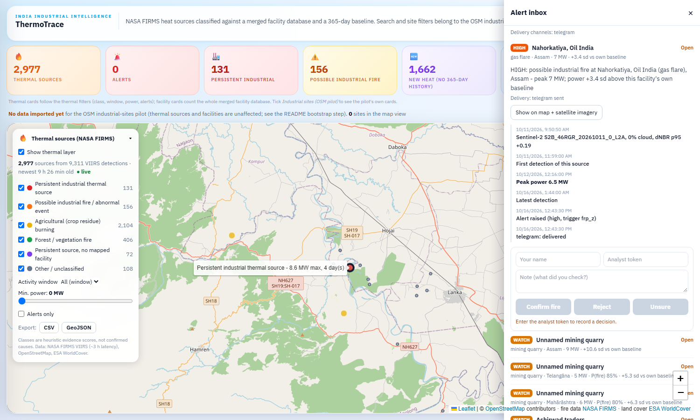

_The inbox lists alerts (open first, then by severity). Opening one shows the incident timeline - Sentinel-2 scene, first detection, peak power, latest detection, alert raised, delivery per channel, analyst decisions - and the decision form; "Show on map + satellite imagery" opens the source panel with the dated chips._

**Rule** (`industrial-data/src/alerts/rules.py`, evaluated by the thermal worker after every cycle that brought new detections). A source alerts when it was seen in the last 24 h, has peak power of at least 5 MW and **either**

* the **P(industrial fire)** is at least 0.6 (`ALERT_P_FIRE_THRESHOLD`) - this is the *rule classifier's* score for `industrial_fire_candidate`: the trained model has no fire class (verified incidents are test-only, see [docs/EVALUATION.md](docs/EVALUATION.md)), so it cannot supply that number; **or**
* it is **at a known facility** (inside the facility's match radius, not merely the nearest one) and its power is at least **3 standard deviations above that facility's own 365-day baseline** (`ALERT_FRP_Z_THRESHOLD`).

**Field-burning veto** (added after the Punjab replay, see [Replay](#replay-prove-it-on-a-real-event)): a source whose surroundings are at least 60 % cropland and which was seen almost only by day (night share below 20 %) is never alerted, whatever mapped facility - landfill, brick kiln, quarry - sits in the field. Without it the peak Punjab burning days raised 58 alerts; with it, 1.

**Severity**: peak power sets the level (`watch` below 40 MW, `high` from 40 MW, `critical` from 100 MW); refineries, LNG, chemical, oil/gas, fuel and fertiliser facilities are raised one level. **Deduplication**: one alert per facility per 6 h (`ALERT_DEDUPE_HOURS`); later cycles inside the window refresh the alert's peak and last detection but never notify again. At most 10 new alerts per cycle (`ALERT_MAX_PER_CYCLE`); the rest are still candidates in the next cycle.

**Delivery** (`src/alerts/notify.py`): webhook (JSON, optional `X-ThermoTrace-Signature` HMAC), Telegram bot, SMTP email. Credentials come from the environment only (`.env`, never committed; variables in `.env.example`). A channel without credentials is skipped; a failing channel is recorded on the alert and retried in later cycles (up to 5 attempts) without blocking the others. `python -m src.alerts test` (inside the worker container) sends a clearly labelled test alert through every configured channel.

**Analyst loop**: `POST /api/alerts/{id}/decision` with `X-Analyst-Token` (= `ANALYST_TOKEN`; empty means decisions are disabled). Every decision is kept in `alert_decisions` and the latest one per alert is written to `labels` (`label_id analyst-alert-<id>`, `unit_type incident`, `label` = `industrial_fire` / `not_industrial_fire` / `unsure`, `rule_version analyst-v1`, `split unused`, with the note and trigger in `detail`). The split keeps analyst labels out of the frozen `labels-v1` evaluation; a later model version can train on them.

**Measured** (2026-10-16, real data, local stack): one cycle on live FIRMS data gave 78 candidate facilities *before* the "at the facility" fix - 70 of them were only the nearest facility, up to 37 km from a crop fire (z-scores of +30 against a mine's baseline) - and **8 alerts** after it (4 by baseline z alone, 4 by both rules; 2 `high`, 6 `watch`); all 8 were delivered to a local fake Telegram API in the same cycle, a second forced cycle created 0 new alerts and sent nothing (8 deduplicated), the CLI test alert was delivered, and a Confirm through the API appeared in `labels` as `analyst-alert-13 | industrial_fire | analyst:faiz | analyst-v1 | unused`. Most of the 8 are 5-11 MW detections at mines and flares: a power z-score says "unusual for this place", not "fire".

**Limits.** No real Telegram bot, SMTP server or webhook receiver was used in testing (local fakes and mocks only); `ANALYST_TOKEN` is one shared secret, not per-user login; the dashboard's top "Alerts" card still counts the older `alert_level` flag, not these alerts; the server does not yet retrain on analyst labels - they are collected and queryable.

## Judge-facing product

| Deliverable | State |
|---|---|
| **Declutter the map** | done: heat-density grid at low zoom, points from zoom 8; industrial and alerting sources are always points; facilities are their own toggle, off by default; the map opens on the whole country (`MapView`, `thermalDensity.ts`, 4 tests) |
| **Dashboard tab** | done: alerts today (by severity, open in the inbox), class mix over time (one point per published FIRMS batch, so as old as the worker), top states with the industrial share, the model card with its CI and caveat; `GET /api/dashboard` |
| **PDF incident report per alert** | done: "Download PDF report" in the inbox, `GET /api/alerts/{id}/report.pdf`: location, why it alerted, two OpenStreetMap maps, the Sentinel-2 after/before chips, dNBR / hot pixels / Landsat, reasons, timeline, analyst decision. [Sample](docs/demo/sample_incident_report.pdf) (Vatva GIDC replay). Says plainly when imagery or tiles are unavailable |
| **Hosted demo on one VM** | **prepared, not deployed.** `docker-compose.prod.yml` + `deploy/Caddyfile` (automatic HTTPS), `DEMO_READONLY` (every write answers 403), nginx rate limits (6 per minute on imagery and PDF), a lean data bundle (`deploy/demo_bundle.py`, ~50 MB). All of it ran locally as a second stack on `https://localhost:8443`; phone layout checked at 390 px with no sideways scroll. No VM, no domain, no public URL: [docs/DEPLOY.md](docs/DEPLOY.md) |
| **2-minute video + 6-slide deck** | made and committed, **not uploaded** to an external host: [overview video](docs/demo/thermotrace_overview.mp4) (1:50), [replay video](docs/demo/thermotrace_replay_demo.mp4) (4 min), deck as [PPTX](docs/deck/ThermoTrace_deck.pptx) and [PDF](docs/deck/ThermoTrace_deck.pdf) (problem, data, model, accuracy, live demo, impact; regenerate with `python docs/deck/build_deck.py`) |

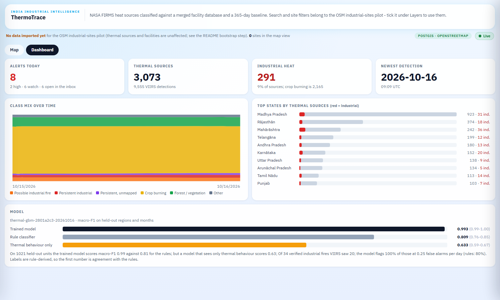

On a phone (390 x 844, captured from the local production stack):

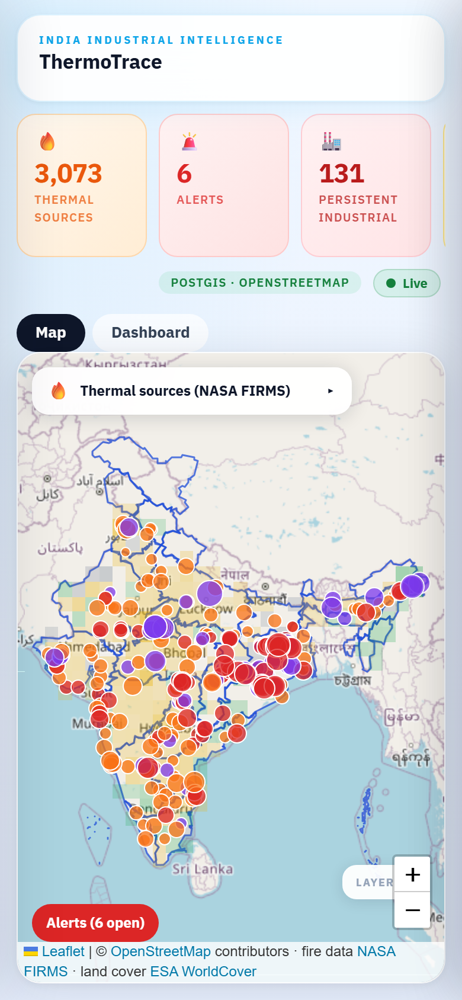 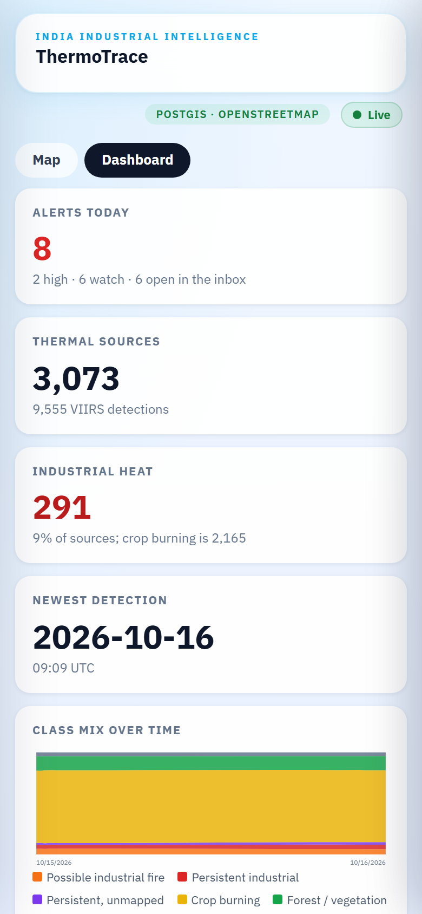 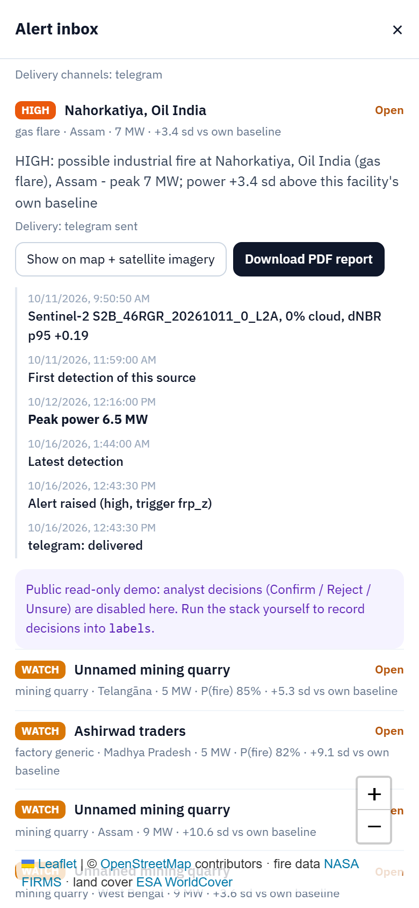

Things that changed on the way: the Alerts card now counts the open alerts in the inbox (it counted the older per-source flag, so it showed 0 beside 6 open alerts); a hidden map (dashboard tab) no longer sends an empty bounding box that made the sites query fail; the first boot of an empty PostGIS container no longer fails `migrate` (the health check probes TCP); phones start with the thermal panel folded and the explanatory text hidden.

## Replay: prove it on a real event

[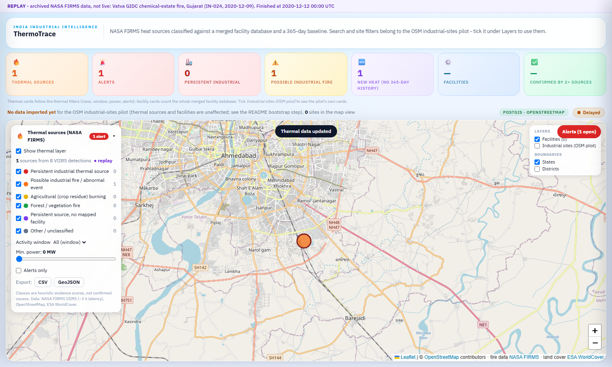](docs/demo/thermotrace_replay_demo.mp4)

_Click for the 4-minute demo video (five scenarios, recorded from the real dashboard, with the REPLAY banner and the virtual clock; in the first one the analyst confirms the alert and the decision lands in `labels`)._

`python -m src.thermal.cli replay --scenario vatva-gidc --speed 60x` feeds archived FIRMS detections through **the same pipeline as the live worker** on a virtual clock: each detection appears 3 h after its overpass, one tick is one worker cycle (cluster, facility match, land cover, rules + model, baseline z-score, PostGIS commit and SSE event, alert rules with deduplication). The baseline uses only detections from before the replay starts. It writes to a separate `<db>_replay` database and snapshot folder; `docker compose --profile replay up -d api-replay` serves it on port 8001 and the dashboard shows a **REPLAY** banner. Details, scenarios and every number below: **[docs/REPLAY.md](docs/REPLAY.md)**.

| Scenario | Expected | Replay result |
|---|---|---|
| Vatva GIDC chemical-estate fire, 2020-12-09 (62 MW) | industrial class + alert | `industrial_fire_candidate`, 1 **high** alert at the first visible detection |
| Barauni refinery effluent fire, 2024-02-10 (6.5 MW) | industrial class + alert | `industrial_fire_candidate`, **high** alerts (refinery severity bump); re-alerts each 6 h window |
| Amudan Chemicals fire, 2024-05-23 (8.6 MW, one detection) | industrial class + alert | `industrial_fire_candidate`, 1 **watch** alert |
| Nahorkatiya gas flare, Assam, 2026-09-01..07 | persistent class, no alert | `industrial_persistent`, 0 alerts |
| Punjab crop-burning peak, 2026-05-08..10 (6,746 sources) | crop burning dominates, at most 3 alerts | 95 % `agricultural_burning`, 1 alert (a persistent 25 MW source at a quarry) |

**What this does not prove.** The three incidents are the ones the pipeline gets right, picked from the 34 verified ones as asked ("curated"). Replaying all of them: 12 have no detection at all, **22 have one, and 5 of those alert (23 %; 15 % of all 34)**. The misses are mostly refineries that are always hot (a fire inside one is invisible at 375 m) and sources too weak or not at a mapped facility - including the 54 MW Jindal Poly Films event (IN-029), classed `other` with no alert because no mapped facility contains the heat and no baseline exists. The first Punjab replay raised 58 false alerts at facilities embedded in farmland; the cropland veto fixes that, but it was made after seeing the failure, so Punjab is now a regression test, not an independent one. The facility map, land cover and model are today's, not those of 2020.

## Facility database (OSM + WRI + Global Energy Monitor + VIIRS Nightfire)

Facilities are merged into one table with provenance: `facilities` (one row per physical facility) and
`facility_sources` (one row per source record: `source`, `source_id`, licence, attribution, distance to the anchor).
Records of a compatible kind within 500 m are one facility (anchored, not chained); authoritative sources (GEM, WRI)
supply the name and coordinates, OSM fills the rest, and the merged matching radius covers every member's own
circle. Capacity is summed within one source (unit-level trackers) and never across sources. GEM units that are
proposed, announced, permitted, cancelled, shelved or retired are dropped: only built infrastructure emits heat.
OSM footprint polygons are kept for power plants, refineries / oil & gas, steel, cement and chemical works
(`facilities.footprint`), bounding boxes give an extent-based radius for the rest.
Nothing is downloaded by the code: each file is obtained under its own terms.

```bash
# drop files into data/facilities/raw (GEM names are recognised: Global-Coal-Plant-Tracker-*.xlsx, ...)
python -m src.facilities.cli build --osm data/thermal/sites_india.geojson --raw-dir data/facilities/raw     --out data/facilities [--postgis]
# or explicitly: --wri <csv> --gem <file>:coal_plant|gas_plant|steel|coal_mine|cement|oil_gas_extraction --vnf <csv>
# Docker: docker compose --profile bootstrap run --rm facilities
```

Sources you leave out are skipped and the printed source counts say so. The thermal pipeline reads
`data/facilities/facilities.geojson` first (`THERMAL_FACILITIES_GEOJSON`; the `facilities` table when
`THERMAL_SITES_FROM_DB=1`). `GET /api/facilities` (bbox / kind / source filters) serves the PostGIS table when the
API runs with `DATA_MODE=postgis`, the files otherwise, always with per-source licences; `GET /api/facilities/{id}`
returns the footprint and every merged source record. On the map the "Facilities" layer lists the attributions,
blue dots are confirmed by 2+ sources, and a click shows the sources with licences and draws the OSM outline.

Current build (2026-10-15): 12,762 facilities from 19,497 OSM records, 397 WRI GPPD thermal plants and 196 VIIRS Nightfire
flare sites (World Bank GFMR); 248 are confirmed by two sources, 580 carry an OSM footprint. GEM is supported but
**not loaded** (its form is behind a bot check a person must pass). On the same FIRMS window the merged facilities change
14 of 5,384 sources: 6 persistent sources gain a power plant only WRI lists; 8 crop/vegetation fires within a
plant's (larger, merged) radius become "fire candidate", which is the known cost of radius-based matching.

| Source | Licence | Access |
|---|---|---|
| OpenStreetMap | ODbL-1.0 | existing Overpass cache |
| WRI Global Power Plant Database | CC BY 4.0 | free CSV |
| Global Energy Monitor trackers | CC BY 4.0 (check each tracker) | free download after a form |
| VIIRS Nightfire (EOG) | EOG terms | free account required (raw detections; optional) |
| VIIRS Nightfire flare sites via World Bank GFMR | CC BY 4.0 | open download, used by default (`--ggfr`, or auto-discovered in `data/facilities/raw`) |

## Architecture

```
NASA FIRMS CSV/API ──► thermal worker ──► snapshot (atomic files) ─┐
OSM facilities  ────►  (cluster, match,   PostGIS (thermal_*) ─────┼─► FastAPI ──SSE/REST──► React + Leaflet
ESA WorldCover  ────►   land cover,       NOTIFY after commit ─────┘
                        classify)
Geofabrik diffs ──► osm2pgsql (append) ──► sync worker ──► industrial_sites (PostGIS, revisioned)
geoBoundaries   ──► states / districts
```

* `industrial-data/` - Python pipeline: `src/sync/` (OSM replication worker), `src/thermal/` (FIRMS classifier), SQL migrations in `sql/migrations/`, legacy batch pipeline (boundaries, entity matching).
* `industrial-gis/backend/` - FastAPI + SQLAlchemy; `industrial-gis/frontend/` - React 18, TypeScript, Vite, Leaflet.
* `docker/`, `docker-compose.yml` - PostGIS, migrations, API, OSM worker, thermal worker, nginx frontend.

## How thermal classification works

1. **Detections → sources.** Detections within ~1 km (DBSCAN, haversine) over the analysis window (up to 14 days; history is kept) form a *source*.
2. **Evidence per source:** days detected, night fraction, radiative power (FRP, MW), footprint (m), distance to the nearest mapped facility inside its matching radius (+500 m for VIIRS geolocation), facility type prior (refinery/steel/power/cement/kiln/mine/landfill/…), ESA WorldCover fractions (crop/vegetation/built/bare) in a 150 m window, month (residue-burning season).
3. **Scoring.** Each of six classes accumulates weighted evidence (`src/thermal/classifier.py`, `WEIGHTS`); a softmax gives *relative* shares. The top class, the margin to the runner-up and the human-readable reasons are stored. Crop/forest classes require land-cover evidence - without it a source stays `other`.
4. **Alerts.** `industrial_fire_candidate` with ≥ 8 MW seen in the last 24 h → `watch`/`high` (≥ 40 MW)/`critical` (≥ 100 MW); or a persistent industrial source whose recent power is ≥ 3× its own mean and ≥ 30 MW.

Classes: `industrial_persistent`, `industrial_fire_candidate`, `agricultural_burning`, `vegetation_fire`, `unmapped_persistent`, `other`.

## Data sources

| Source | Use | Licence / terms | Notes |
|---|---|---|---|
| NASA FIRMS (LANCE) VIIRS NRT | thermal detections | open, attribute NASA FIRMS | host is `firms.modaps.eosdis.nasa.gov` (note *modaps*); ~3 h latency |
| OpenStreetMap via Geofabrik / Overpass | facilities, industrial sites | ODbL 1.0 © OSM contributors | regional diffs are published ~daily; one cached bounded Overpass query for the thermal facility list |
| geoBoundaries gbOpen (IND ADM0/1/2) | states/districts | CC BY 4.0 | |
| ESA WorldCover 2021 v200 | land cover | CC BY 4.0 | read from public COGs |
| India Industrial Land Bank, Industrial Corridor Land Platform, NCoG / UP Industrial Parks GIS | - | - | **Not integrated.** Hosts did not resolve / connect from the build environment on 2026-10-09 and no authorised export was established. They are registered as `not_configured` and never presented as live. |

OSM-derived records are **not** government-verified; the UI says so. Basemap tiles come from `tile.openstreetmap.org` (light use; set `VITE_TILE_URL` for production).

## Quick start

Requirements: Docker with Compose v2 (or Python 3.12 + Node 22 + PostGIS), ~10 GB free disk for the pilot import.

```bash
cp .env.example .env                      # set POSTGRES_PASSWORD (URL-safe)
docker compose up -d --build db migrate api worker thermal frontend
docker compose --profile bootstrap run --rm bootstrap          # one-time OSM baseline (OSM_REGION in .env)
docker compose --profile bootstrap run --rm thermal-bootstrap  # one-time India-wide facility cache for thermal matching
docker compose --profile bootstrap run --rm facilities         # merge OSM + WRI/GEM/VNF files from data/facilities/raw
docker compose --profile bootstrap run --rm baseline           # FIRMS archive in data/archive -> 365-day baseline view
# UI: http://localhost:8080   API docs: http://localhost:8000/api/docs
```

Standalone thermal analysis, no database:

```bash
cd industrial-data
pip install -r requirements.txt
python scripts/fetch_thermal_sites.py --out ../data/thermal/sites_india.geojson   # one bounded Overpass query
python -m src.facilities.cli build --osm ../data/thermal/sites_india.geojson --out ../data/facilities   # add --raw-dir for WRI/GEM/VNF files
THERMAL_FACILITIES_GEOJSON=../data/facilities/facilities.geojson \
  python -m src.thermal.cli refresh --out ../data/thermal/live                   # writes the snapshot the API serves
```

Development without Docker for the app: run PostGIS yourself, then `uvicorn backend.app.main:app` from `industrial-gis/` (`DATABASE_URL`, `DATA_MODE=postgis`) and `npm run dev` in `industrial-gis/frontend`. `DATA_MODE=synthetic` serves ~30 invented sites for offline UI tests only and the UI labels it *DEMO*.

## API (all under `/api`)

| Endpoint | Purpose |
|---|---|
| `GET /health` | liveness, database readiness, dataset counts, data revision (reported separately) |
| `GET /industries`, `/industries/search`, `/industries/{id}`, `/industries/export` | sites; filters `bbox,state,district,industry_type,status,confidence,q`, `limit/offset`; export streams **all** matches |
| `GET /statistics`, `/filters/options`, `/boundaries/{level}` | counts over the filter scope; cascading options; simplified boundaries |
| `GET /thermal/sources`, `/thermal/sources/{id}`, `/thermal/stats`, `/thermal/export`, `/thermal/classes`, `/thermal/status` | thermal layer; filters `thermal_class,bbox,state,site_kind,min_frp,alerts_only,hours` |
| `GET /facilities`, `/facilities/{id}` | merged facilities (`bbox,kind,source,limit`) with per-source licences; detail adds the OSM footprint and every source record |
| `GET /sync/status`, `/sync/history` | per-source freshness (`live/syncing/delayed/offline/not_configured/awaiting_setup`) |
| `GET /events` | Server-Sent Events: `hello`, `revision`, `sync`, `thermal`; the UI falls back to 10 s polling |
| `GET /dashboard` | alerts today, class mix over time, top states, model card |
| `GET /alerts/{id}/report.pdf` | PDF incident report (maps, imagery, reasons, timeline) |
| `GET /alerts`, `/alerts/{id}` | alert inbox (`status=open|confirmed|rejected|unsure`); detail adds the incident timeline and decisions |
| `POST /alerts/{id}/decision` | `{decision: confirmed|rejected|unsure, note, analyst}`; needs `X-Analyst-Token` (`ANALYST_TOKEN`), writes `labels` |
| `POST /admin/sync/trigger` | asks the worker to sync now; needs `ADMIN_TOKEN` (`X-Admin-Token`), disabled when unset |

"Live" never means "the API answers": it means checked recently, caught up with the source, and within the source's freshness target (36 h for daily OSM diffs; FIRMS checked every 10 min with newest data < 12 h old). `/sync/status` and the status panel list OSM and NASA FIRMS side by side with last check, last data change and last commit as separate times.

## Tests

```bash
cd industrial-gis && DATA_MODE=synthetic python -m pytest backend/tests          # API + thermal contracts, no DB
cd industrial-data && python -m pytest tests                                      # pipeline, thermal, facilities (PostGIS ones skip)
TEST_DATABASE_URL=postgresql://user:pw@localhost:5432/postgres DATA_MODE=postgis \
  python -m pytest industrial-gis/backend/tests/postgis                           # API against PostGIS (throw-away database)
TEST_DATABASE_URL=postgresql://user:pw@localhost:5432/postgres python -m pytest tests/sync   # needs PostGIS
cd industrial-gis/frontend && npx tsc --noEmit && npm test && npm run build
```

Results on the development machine (2026-10-15): `industrial-data/tests` 350 passed with PostGIS available (about 310 without; includes the ML, imagery, alert and replay tests); API synthetic suite 74 passed (dashboard, PDF report, read-only mode); API against PostGIS 40 passed (alert inbox, report, dashboard); frontend `tsc` clean, vitest 64 passed. GitHub Actions: the pushes to `main` completed with `success`.

## Configuration

See `.env.example`. Key variables: `POSTGRES_*`, `ALLOWED_ORIGINS`, `ADMIN_TOKEN`, `OSM_REGION`, `OSM_POLL_INTERVAL_SECONDS`, `OSM_FRESHNESS_TARGET_SECONDS`, `FIRMS_MAP_KEY` (optional), `THERMAL_INTERVAL_SECONDS` (default 600), `THERMAL_FACILITIES_GEOJSON`, `FACILITIES_DIR`, `FACILITIES_BACKEND` (`auto`/`files`/`postgis`), `THERMAL_WINDOW_DAYS`, `THERMAL_IMAGERY` (on by default), `THERMAL_IMAGERY_DIR`, `THERMAL_IMAGERY_PER_CYCLE` (default 4), `THERMAL_IMAGERY_BUDGET_SECONDS` (default 240), `ANALYST_TOKEN`, `ALERT_*` thresholds (incl. `ALERT_VETO_CROP_FRACTION`, `ALERT_VETO_NIGHT_FRACTION`), `REPLAY_DATABASE_URL`, `DEMO_READONLY`, `DOMAIN` (production compose), `REPORT_TILE_URL`, `VITE_TILE_URL` (build arg), `TELEGRAM_BOT_TOKEN` / `TELEGRAM_CHAT_ID`, `ALERT_WEBHOOK_URL` / `ALERT_WEBHOOK_SECRET`, `SMTP_*` / `ALERT_EMAIL_FROM` / `ALERT_EMAIL_TO`, `VITE_TILE_URL`. Never commit `.env`.

## Known limitations

* The live classifier is a model trained on **weak rule-derived labels, not ground truth** (the rules stay as baseline and fallback); incident evidence covers 34 of 40 documented incidents (6 could not be verified or located), 10 of them only to a named locality, and is mostly near the detection floor. Agricultural vs. other low-power vegetation fires and industrial vs. unmapped industry depend on OSM completeness.
* Sentinel-2 imagery is often unavailable (cloud, especially in the monsoon) and confirms burn scars, not fires inside buildings; "no scene" is reported as such.
* VIIRS is 375 m and ~3 h behind real time; a short-lived industrial event can fall between overpasses. Persistence needs history: the first run only has the 7 days FIRMS publishes (history accumulates afterwards).
* Facility matching uses a radius around a representative point (the equivalent-area radius of the OSM outline where one is stored, else the outline's bounding box, else a kind default); large plants can be missed or over-matched, and merging records widens the circle (on one FIRMS window, 8 of 5,384 crop/vegetation sources became "fire candidate" for that reason).
* Global Energy Monitor trackers (steel, coal mines, cement, oil and gas plants) are not loaded: the download form is protected by a Cloudflare bot check that a person has to complete. Their loader is tested on fixtures, not on the real files.
* OSM footprints are stored only for power plants, refineries, steel, cement and chemical works (3,800 outlines, 580 attached to merged facilities); mines, landfills and generic works are bounding boxes.
* OSM sites cover only the imported region; thermal facility matching is India-wide. 105 pilot sites sit outside geoBoundaries' state polygons (neighbouring countries / border simplification).
* OSM industrial tags describe land use or features, not confirmed operation; `status` is `mapped` unless disused/abandoned/construction is tagged.
* Regional OSM diffs are published about daily, so freshness of the sites layer is bounded by the source, not the worker.
* Government land-bank sources are not integrated (see above).
* Docker Desktop needs the C: drive free-space headroom while importing; the pilot database is ~2 GB, a larger zone needs proportionally more.

## Licence and attribution

Code: see `LICENSE`. Data: © OpenStreetMap contributors (ODbL 1.0); NASA FIRMS / LANCE; ESA WorldCover 2021 © ESA, CC BY 4.0; geoBoundaries CC BY 4.0; basemap tiles © OpenStreetMap contributors.
