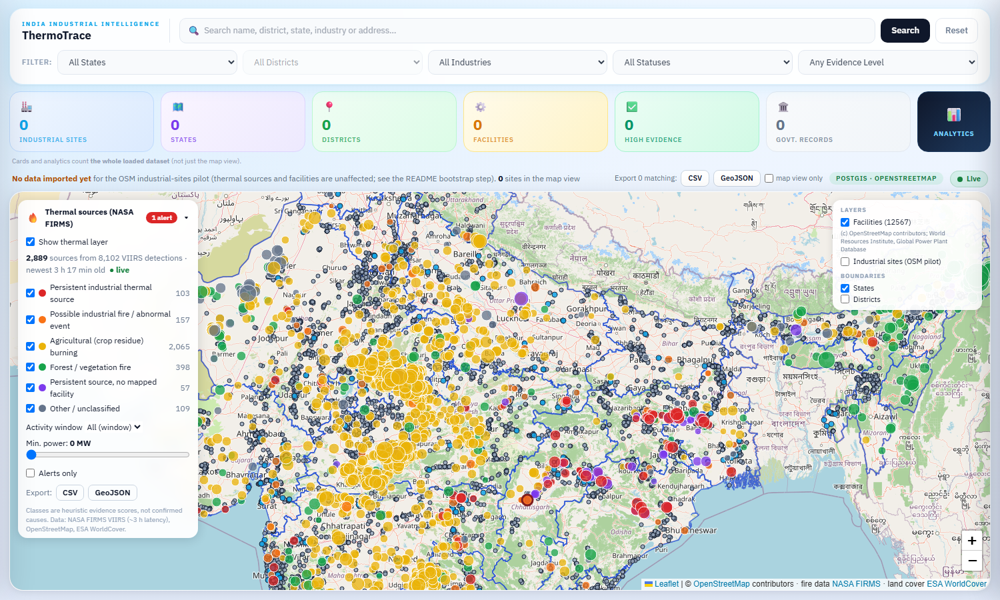
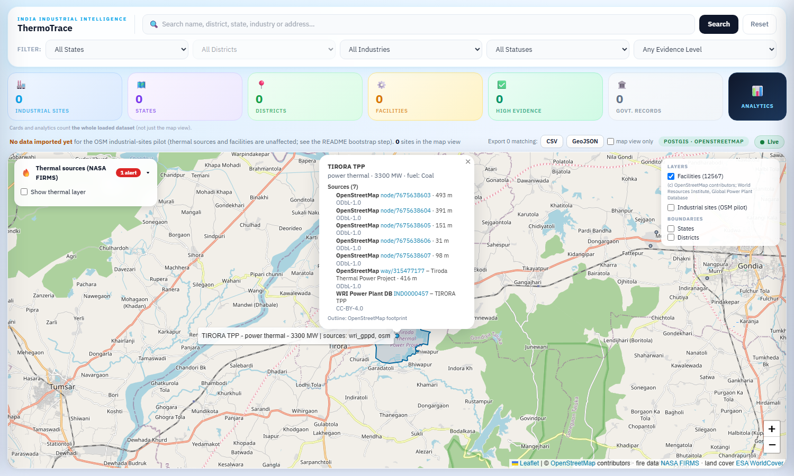
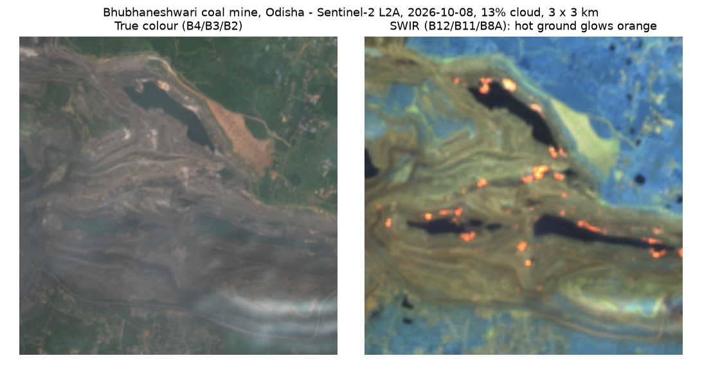
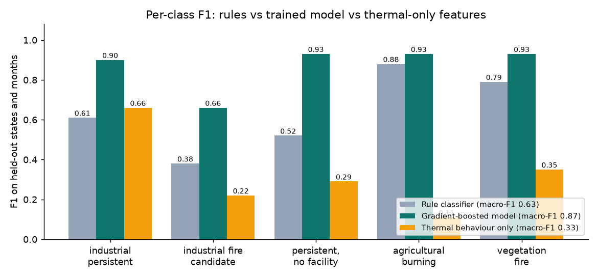
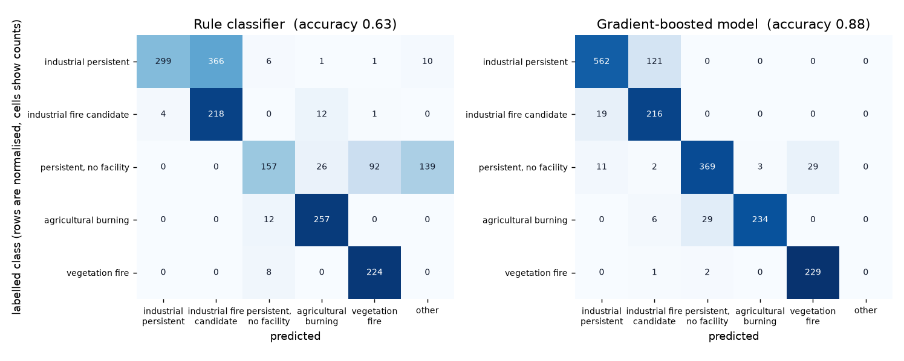
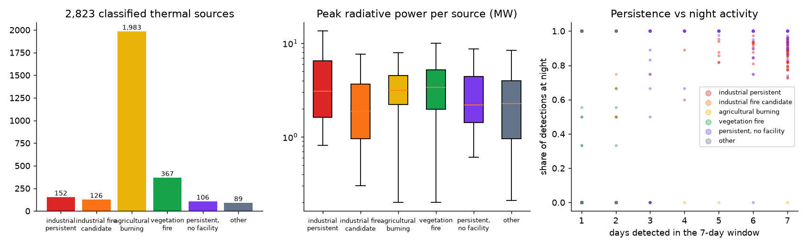
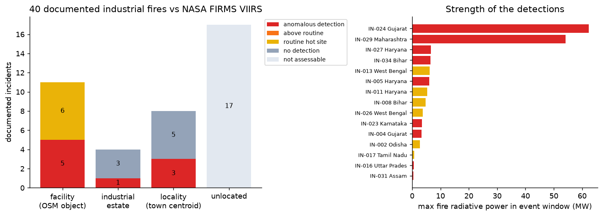
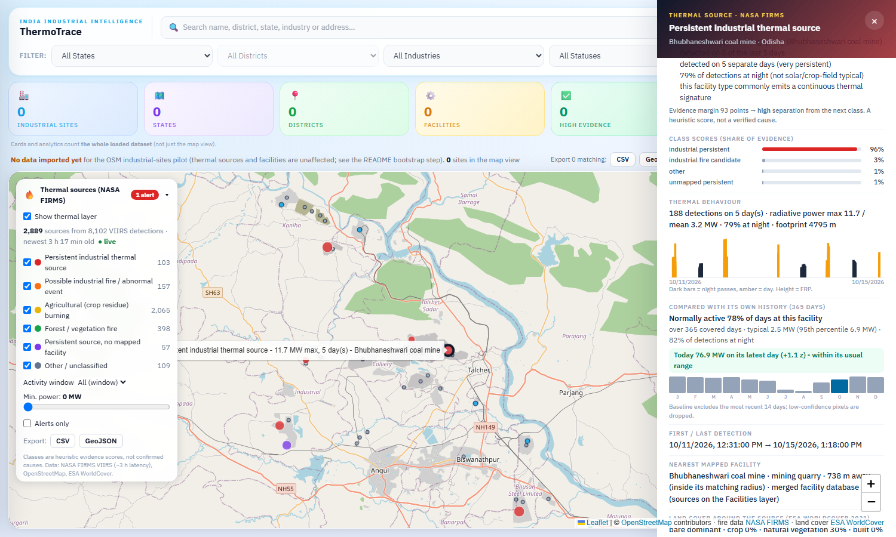
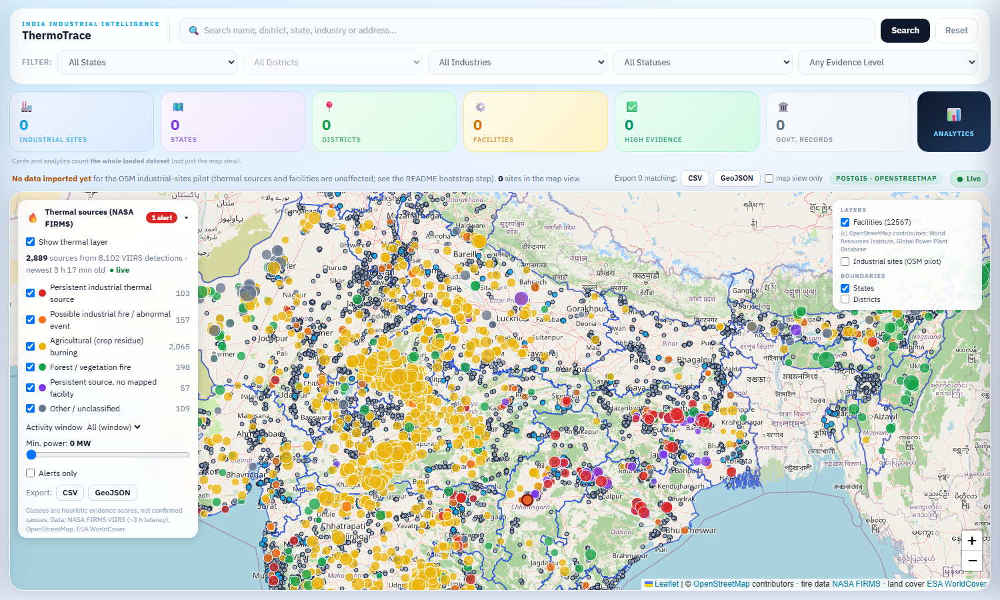

# ThermoTrace

<p align="center">
<pre>
 _____ _                             _____                   
|_   _| |__   ___ _ __ _ __ ___   __|_   _| __ __ _  ___ ___ 
  | | | '_ \ / _ \ '__| '_ ` _ \ / _ \| || '__/ _` |/ __/ _ \
  | | | | | |  __/ |  | | | | | | (_) | || | | (_| | (_|  __/
  |_| |_| |_|\___|_|  |_| |_| |_|\___/|_||_|  \__,_|\___\___|
</pre>
</p>

<p align="center">
  
  
  
  
  
  
  
  
  
  
  
  
  
  
  
  
  
  
  
</p>

# ThermoTrace - India industrial intelligence + thermal-source classification

ThermoTrace is a Web GIS that does two things on one map:

1. **Industrial sites** - industrial facilities mapped in OpenStreetMap, stored in PostGIS and kept in sync by a background worker (state/district assignment, filters, search, exports, live updates).
2. **Thermal sources** - NASA FIRMS (VIIRS 375 m) heat detections grouped into persistent *sources* and classified as **industrial vs. agricultural vs. forest fire**, using the facility map and ESA WorldCover land cover, with a plain-language explanation for every decision.

> FIRMS shows *where heat was seen*, not *why*. ThermoTrace scores competing explanations from physical evidence (persistence, night activity, radiative power, footprint, nearby facility, land cover, season). The weights are **expert-set priors, not trained on labelled ground truth**, and the output is a decision-support hint to be confirmed with imagery - never an official determination.

---

## Dashboard



_Dashboard captured 2026-10-15 from the Docker stack (PostGIS, API, thermal worker, frontend): 2,757 classified FIRMS thermal sources from 7,807 VIIRS detections, status "live" (newest detection about 3 h old), over the 12,567-facility layer (small dots; blue = confirmed by two or more sources). Filled circles are thermal sources (size = radiative power, colour = class, dark ring = alert). The left panel filters by class, window, minimum power and alerts and exports CSV/GeoJSON; the top-right box toggles the facility layer (with the source attributions), the OSM north-east pilot layer and the boundaries. The site cards read 0 because the optional OSM north-east pilot import was not run on this fresh database; the header says so instead of covering the map._



_Clicking a facility shows where it comes from. Tirora TPP (3,300 MW, coal) is one facility built from six OpenStreetMap records and one WRI Global Power Plant Database record, each listed with its source id, distance to the anchor and licence; the blue outline is the OpenStreetMap footprint of the plant._



_Clicking a thermal source shows a Sentinel-2 chip pair from the clearest scene within 5 days (here a coal mine in Odisha: the SWIR composite shows glowing, burning coal seams)._

## Findings

All figures are produced by `industrial-data/scripts/make_figures.py` from the real result files. Read the caveats: labels are weak and rule-derived, incident locations are partly coarse, and one snapshot of one week is not a trend.

**1. A trained model fixes the rules' main weakness.** On held-out states and months the gradient-boosted model reaches macro-F1 0.87 against 0.63 for the rules. The rules call 559 of 1,022 persistent industrial windows "fire candidate" (recall 0.44) and send 151 of 531 persistent unmapped sources to "other" (recall 0.37); the model recovers them (recall 0.83 and 0.89) at the price of slightly lower agricultural recall (0.93 vs 0.96).




**2. Context, not satellite behaviour alone, separates the classes.** Thermal-behaviour features alone (persistence, night share, power, footprint) score macro-F1 0.33; adding facility proximity and land cover gives 0.87. FIRMS tells you where heat is, the facility map and land cover tell you why. This is also a caution: those context features define the labels, so the score is agreement with the labelling rules.

**3. Radiative power does not separate industrial from agricultural fires.** Median peak power per source is 3.1 MW for persistent industrial, 3.2 MW for crop burning and 3.4 MW for vegetation fire; night share and persistence do the separating (median night share 1.0 for the industrial classes, 0.0 for crop and forest fires).



**4. Persistent "industrial" heat in this pilot is mostly coal.** Of 152 persistent industrial sources in the 2026-10-02 to 2026-10-08 run, 86 sit on OSM mining/quarry features and 42 on thermal power plants (only 2 refineries, 2 steel plants, 3 cement works). By state: Jharkhand 33, Odisha 28, Chhattisgarh 16, Maharashtra 14, Rajasthan 10. Burning coal seams and overburden dumps are a heat source a facility list alone would not explain.

**5. Satellite evidence for documented incidents is thin and depends on location quality.** Of 40 documented industrial fires, 17 could not be located well enough to test. Of the 23 tested, 9 show an anomalous VIIRS detection, 6 sit on a site that is routinely hot (a refinery fire is not separable from baseline at 375 m), and 8 show nothing. The two strongest signals (Vatva GIDC 62 MW, Igatpuri/Jindal Poly Films 54 MW) are industrial-estate or town-level locations; facility-level matches are mostly under 7 MW. The bottleneck is verified facility coordinates, not the satellite archive.



**6. Honest limits of the numbers.** One train/test split, one seed, S-NPP only, no confidence intervals; "industrial fire candidate" means an episodic detection at a facility, not a confirmed fire; the trained model is not yet in the live pipeline.

Regenerate: `python industrial-data/scripts/train_classifier.py && python industrial-data/scripts/make_figures.py` (matplotlib is only needed for the figures); the dashboard screenshot comes from `industrial-data/scripts/capture_dashboard.py` against a running app.

## Project status

| Phase | Scope | State |
|---|---|---|
| 0 | Clean foundation: legacy tests green, thermal layer is the default map, honest README badges | **done** |
| 1 | Facility database with provenance: OSM + WRI GPPD + GEM + VIIRS Nightfire, PostGIS, API, map layer | **OSM + WRI done; GEM and VNF not loaded** (loaders tested on fixtures; registration/account required) |
| 2 | 12-month FIRMS baseline per facility and per 1 km cell (S-NPP + NOAA-20), z-score of today against it, shown for every source | **done** (see [Baseline](#baseline-what-is-normal-for-this-place)) |
| 3-9 | labelled evaluation set, model in the live pipeline, imagery as features, alerting, replay demo, judge-facing dashboard | planned - see [docs/IMPLEMENTATION_PLAN.md](docs/IMPLEMENTATION_PLAN.md) |

## Baseline: what is normal for this place

A persistent flare, kiln or coal-seam fire is normal for its place; a new fire is not. Seven days of FIRMS cannot
tell them apart, so every thermal source is compared with **365 days of the same place** (VIIRS S-NPP + NOAA-20
from the FIRMS archive: standard-processing data through 2026-06-30, near-real-time after that).



_Source detail panel (captured 2026-10-15 from the Docker stack): Bhubhaneshwari coal mine (Odisha) is normally active on 78% of days at this facility over 365 covered days, typical detection 2.5 MW (95th percentile 6.9 MW), 82% of detections at night; its latest day summed 76.9 MW, z = +1.1 against its own daily history, so "within its usual range" - a routine coal-mine fire, not a new event. The bars are the share of active days per month (current month highlighted)._

| Definition | Value |
|---|---|
| Window | 365 days ending 14 days before the newest detection (2025-10-01 .. 2026-09-30 for the 2026-10-14 run), so the live window is not part of its own baseline |
| Entities | **facility** (a detection belongs to the facility whose radius + 500 m contains it with the largest margin) and **1 km cell** (EPSG:6933 equal-area grid) |
| Covered day | a window day on which the archive holds any detection - archive gaps are not counted as quiet days |
| Detections used | low-confidence pixels dropped; one physical detection held as both SP and NRT counted once (SP wins) |
| Per entity | active-day fraction, 12-month active profile, median and 95th-percentile FRP, night share, mean/std of daily FRP (inactive days = 0) |
| z-score | `(FRP today - daily mean) / max(daily std, 1 MW)`; "today" = the entity's latest day in the live window, summed over every detection of that entity |
| "Never seen" | an entity with no detection in the window is reported as new heat (0% of days), not as a routine source |

Where it lives: `sql/migrations/006_thermal_baseline.sql` (materialised view `thermal_baseline`, `thermal_detection_geo`,
`assign_thermal_geo()`, `product`/`satellite`/`acq_date` columns on `thermal_detections`), `src/thermal/baseline.py`
(the same numbers computed with pandas for the no-database mode; `tests/sync/test_baseline_postgis.py` checks that the
SQL view and the pandas code agree entity by entity).

```bash
python -m src.thermal.baseline download --start 2025-10-01 --family SNPP --family NOAA20 --out ../data/archive   # needs FIRMS_MAP_KEY
python -m src.thermal.baseline report  --archive ../data/archive/snpp --archive ../data/archive/noaa20   # gaps, products
python -m src.thermal.baseline load    --archive ../data/archive/snpp --archive ../data/archive/noaa20   # -> PostGIS + view
python -m src.thermal.baseline compute --archive ../data/archive/snpp --archive ../data/archive/noaa20   # file mode (parquet)
```

Loading the archive into PostGIS (`baseline load`, local Docker stack, 2026-10-15): 1,874,454 detections inserted, each assigned to its facility and 1 km cell, and the view built in 710 s: 651,831 baseline rows, 4,993 of them facilities (the pandas build gives 651,824; the few-entity difference is the facility search: PostGIS checks every facility within 6.5 km, the pandas twin the 8 nearest).

Live Docker worker, 2026-10-15: every one of the 2,757 current sources carries the baseline fields from the PostGIS view; 1,231 have history at their place, and the 102 persistent industrial sources are normally active on a median 58 % of days.

Result on the 2026-10-14 run (5,418 current sources, 365 covered days, 651,824 baseline entities from 1.88 million archive detections):

* 2,046 sources have history at their place, 3,372 do not (new heat for that cell: 2,725 of them are crop burning, 521 vegetation fire).
* Persistent industrial sources are the routine ones: 187 of 188 have history, normally active on a median **42 % of days** (not ~100 %: cloud and monsoon hide a true 24/7 source from a 375 m sensor on many days). Crop-burning sources with a history are active on a median 0.3 % of days.
* z-score: 1,310 sources are within their usual range or below (< 2), 2,209 are elevated (2 to 4), 1,866 are far above (>= 4) - almost all of the latter are fires in places with no history, where the 1 MW std floor makes any detection a large z.

### Verification of phases 0-2 (2026-10-15, Docker stack on this machine)



| Phase | Item | Result | Evidence |
|---|---|---|---|
| 0 | Frontend Docker build | **pass** | `docker compose build frontend` built; the nginx image serves the UI and proxies `/api` on :8080 (screenshot above). nginx now re-resolves the API container, so recreating it no longer leaves a 502 |
| 0 | CI green | **pass** | the GitHub Actions runs for the last six pushes to `main` finished with `success` (API, PostGIS and frontend jobs) |
| 0 | PostGIS API suite | **pass** | 34 passed, 0 failed (`backend/tests/postgis`, throw-away database) |
| 0 | Legacy pipeline tests | **pass** | `industrial-data/tests`: 288 passed, 0 skipped with PostGIS available (261 passed + 27 skipped without a database) |
| 0 | Facilities in PostGIS, matching reads them | **pass** | table `facilities`; the Docker worker (`THERMAL_SITES_FROM_DB=1`) loads 12,567 rows from it. The GeoJSON file remains a fallback for the no-database mode only |
| 0 | OSM pilot layer behind a toggle | **pass** | off by default, map shows thermal sources + facilities |
| 0 | Badges match the code | **pass** | Redis, Celery, MapLibre, Plotly, SciPy removed |
| 1 | OSM + WRI in PostGIS with provenance | **pass** | 19,497 OSM + 397 WRI records -> 12,567 facilities in `facilities`, every record in `facility_sources` with source id, licence, attribution; 247 plants confirmed by both; 580 OSM outlines |
| 1 | Global Energy Monitor trackers | **not done** | loader and tests exist (fixtures), but GEM data sits behind a registration form (name, organisation, terms) and has not been downloaded |
| 1 | VIIRS Nightfire flare sites | **not done** | loader and tests exist (fixtures); needs a free EOG account |
| 1 | Facilities layer with source attribution | **pass** | `/api/facilities` (PostGIS) + map layer, attribution list and per-record licences in the popup |
| 2 | 12 months of S-NPP + NOAA-20, `product` column | **pass** | 1,874,454 detections (SP 1,815,205, NRT 62,066) in `thermal_detections`; 365 covered days |
| 2 | `thermal_baseline` view | **pass** | 651,898 rows (facility and 1 km cell) with active-day fraction, 12-month profile, median/p95 FRP, night share |
| 2 | Every current source: "normally active X% of days, typical FRP Y MW" + z-score | **pass** | of 2,889 current sources, 2,889 have the active-day fraction and a z-score; 1,274 have history at their place (typical FRP shown), the other 1,615 are "never seen here" |

Phase 1 is therefore complete for the two open sources (OSM, WRI) and **incomplete for GEM and VNF**: two of the four
sources the plan lists are not loaded, because both require a registration only the account owner can do.

## What is implemented (and verified)

| Area | Status |
|---|---|
| FIRMS ingestion (S-NPP, NOAA-20, NOAA-21 VIIRS NRT; public CSV or `MAP_KEY` API) | working, run against real data |
| Clustering into thermal sources, facility matching, land-cover sampling, explainable classifier | working, 24 unit tests |
| Thermal layer on the map, class filters, alert flag, source detail panel with reasons + detection timeline, Sentinel-2 true-colour/SWIR chip (clearest scene within 5 days, < 30 % cloud, `/api/thermal/sources/{id}/imagery`), CSV/GeoJSON export | working (frontend tests + browser check of the map layer) |
| Snapshot **and** PostGIS storage (`thermal_sources`, `thermal_detections`, `thermal_runs`) | PostGIS path run against a real PostGIS container |
| OSM industrial sites: baseline import + incremental replication (osm2pgsql) with durable checkpoint, locking, backoff, revisions | 23 lifecycle tests; baseline imported (below); catching up to the live diff feed **not observed to completion** |
| Merged facility database (OSM 19,497 records + WRI GPPD 397 plants -> 12,567 facilities, 247 confirmed by both, 580 with OSM footprints) with per-record source id, licence and attribution; `facilities` / `facility_sources` tables, `/api/facilities` (PostGIS or files), map layer with provenance popup | 18 unit tests, 5 API tests (files), 4 API tests against PostGIS, 3 popup tests; PostGIS load run against a real PostGIS container |
| 365-day baseline per facility / 1 km cell (archive download with product-boundary handling, bulk PostGIS load, materialised view, pandas twin, z-score per source, detail-panel row) | 9 unit tests, 4 SQL-vs-pandas parity tests against PostGIS, 4 UI tests; run on 1.88 M real detections |
| REST API, SSE change notifications with polling fallback, live-status panel | tests below |
| Government sources (India Industrial Land Bank, ICLP, NCoG) | **not integrated** - see [Data sources](#data-sources) |

### Measured results (2026-10-09, real data, not fabricated)

* **Industrial sites (pilot)**: 2,794 active OSM industrial features from the Geofabrik *North-Eastern Zone* extract (Assam 2,160, Tripura 230, Arunachal 77, Sikkim 63, Meghalaya 60, Manipur 39, Nagaland 28, Mizoram 26, West Bengal 6; 105 fall outside the geoBoundaries state polygons and show as *Unassigned*). This is a regional pilot, **not national coverage**.
* **Thermal run** (VIIRS, 2026-10-02 → 2026-10-08, India): 14,437 detections in the South-Asia files → 11,114 inside India → **2,823 thermal sources**, matched against 19,497 thermally relevant OSM facilities (23,014 fetched, India-wide):

  | Class | Sources |
  |---|---|
  | Agricultural burning | 1,983 |
  | Forest / vegetation fire | 367 |
  | Persistent industrial thermal source | 152 |
  | Possible industrial fire / abnormal event | 126 |
  | Persistent, no mapped facility | 106 |
  | Other | 89 |

  The persistent-industrial list is plausible: it is dominated by Odisha/Jharkhand coal mines, plus e.g. Tata Steel Meramandali, Jindal Raigarh and Jojobera power stations - night-time detections on 7 of 7 days. The rule-based classes were then checked against the incident list and a trained model (below).
* **Documented industrial-fire incidents vs NASA FIRMS** (40 public-source incidents, 2016-2025, matched against the VIIRS S-NPP/NOAA-20 archive; script `industrial-data/scripts/match_incidents.py`). Event window = date -1 / +2 days, baseline = 60 to 8 days before, radius = location uncertainty + 0.5 km, "routine" = active on >= 30 % of baseline days. Query parameters are stored with the results.

  | Outcome | Incidents |
  |---|---|
  | Not assessable (no verified facility/area location) | 17 |
  | Anomalous VIIRS detection near the incident (quiet baseline) | 9 |
  | No detection | 8 |
  | Detection but the site is routinely hot (cannot attribute) | 6 |

  The 9 anomalous matches: Jamnagar FCCU flash fire 2016-11-24 (1 det., 3.3 MW), Panipat Naphtha Cracker 2018-01-22 (3, 6.0 MW), Mathura refinery 2020-01-07 (1, 0.6 MW), Vatva GIDC 2020-12-09 (8, 62.4 MW), Numaligarh hydrocracker 2023-05-29 (1, 0.5 MW), Barauni ETP 2024-02-10 (4, 6.5 MW), plus three locality-level matches (Bengaluru 2020-11-10, Kundli 2022-04-17, Igatpuri/Jindal Poly Films 2023-01-01: 17 det., 54.1 MW). **Read with care:** facility-level matches are mostly under 7 MW, near the VIIRS detection floor; locality-level matches use a 5 km centroid, so nearby unrelated heat can match; a match is *a* thermal anomaly at the right place and time, not proof of the reported fire; no detection does not mean no fire (375 m pixels, cloud, small fires between passes). Only 11 of 40 incident locations are facility-level (OSM named objects), 4 industrial-estate level, 8 locality, 17 unlocated.
* **Trained classifier vs rules** (`docs/EVALUATION.md`, `industrial-data/scripts/train_classifier.py`). Gradient-boosted trees (scikit-learn `HistGradientBoostingClassifier`) on 7-day source windows from the S-NPP archive (2025-07 to 2026-10, 562k detections in India). Strict hold-out: test = 11 held-out states AND windows from 2026-04-01; train = other states and earlier windows (4,382 train / 2,318 test windows).

  | | macro-F1 | accuracy |
  |---|---|---|
  | Rule classifier | 0.634 | 0.587 |
  | Gradient-boosted model | **0.872** | **0.885** |
  | Gradient-boosted, thermal-behaviour features only | 0.325 | 0.449 |

  Per-class F1 rules -> model: industrial persistent 0.61 -> 0.90, industrial fire candidate 0.38 -> 0.66, persistent no mapped facility 0.52 -> 0.93, agricultural burning 0.88 -> 0.93, vegetation fire 0.79 -> 0.93. **These labels are weak and rule-derived, not ground truth:** they come from each ~2 km cell's long-run activity over the archive, OSM facility proximity and WorldCover land cover, and the last two are also model inputs, so the scores measure agreement with the labelling rules on unseen regions/months, not real-world accuracy. The thermal-only score (0.33) shows satellite behaviour alone barely separates the classes. "Industrial fire candidate" means *episodic detection at a facility*, not a confirmed fire. One split, one seed, S-NPP only, no confidence intervals. The trained model is not yet wired into the live pipeline; the live app still uses the rule classifier.
* **Real-time chain, measured once on 2026-10-09 (single observation, not a benchmark):** the thermal worker polls FIRMS every 10 min and publishes only when new detections arrive. For a batch of 40 new detections the FIRMS file was published 07:45:42 UTC and committed to PostGIS at 07:48:57 (**195 s**); the `thermal` SSE event reached the API stream ~0.02 s after the commit. Worst case is the poll interval plus ~17 s of processing; the satellite-to-file delay (~3 h) is upstream and not under our control. The OSM worker checks Geofabrik every 5 min and was caught up (cursor = source head), but Geofabrik regional diffs are published about **once a day**, so a new-OSM-edit-to-screen lag of hours is inherent to that source; no OSM diff was applied during this check. Browser repaint delay was not measured.
* The lifecycle tests assert the mechanics (notification only after commit, checkpoint never advances on failure, unchanged data publishes nothing); they are not latency benchmarks.

---

## Facility database (OSM + WRI + Global Energy Monitor + VIIRS Nightfire)

Facilities are merged into one table with provenance: `facilities` (one row per physical facility) and
`facility_sources` (one row per source record: `source`, `source_id`, licence, attribution, distance to the anchor).
Records of a compatible kind within 500 m are one facility (anchored, not chained); authoritative sources (GEM, WRI)
supply the name and coordinates, OSM fills the rest, and the merged matching radius covers every member's own
circle. Capacity is summed within one source (unit-level trackers) and never across sources. GEM units that are
proposed, announced, permitted, cancelled, shelved or retired are dropped: only built infrastructure emits heat.
OSM footprint polygons are kept for power plants, refineries / oil & gas, steel, cement and chemical works
(`facilities.footprint`), bounding boxes give an extent-based radius for the rest.
Nothing is downloaded by the code: each file is obtained under its own terms.

```bash
# drop files into data/facilities/raw (GEM names are recognised: Global-Coal-Plant-Tracker-*.xlsx, ...)
python -m src.facilities.cli build --osm data/thermal/sites_india.geojson --raw-dir data/facilities/raw     --out data/facilities [--postgis]
# or explicitly: --wri <csv> --gem <file>:coal_plant|gas_plant|steel|coal_mine|cement|oil_gas_extraction --vnf <csv>
# Docker: docker compose --profile bootstrap run --rm facilities
```

Sources you leave out are skipped and the printed source counts say so. The thermal pipeline reads
`data/facilities/facilities.geojson` first (`THERMAL_FACILITIES_GEOJSON`; the `facilities` table when
`THERMAL_SITES_FROM_DB=1`). `GET /api/facilities` (bbox / kind / source filters) serves the PostGIS table when the
API runs with `DATA_MODE=postgis`, the files otherwise, always with per-source licences; `GET /api/facilities/{id}`
returns the footprint and every merged source record. On the map the "Facilities" layer lists the attributions,
blue dots are confirmed by 2+ sources, and a click shows the sources with licences and draws the OSM outline.

Current build (2026-10-15): 12,567 facilities from 19,497 OSM records and 397 WRI GPPD thermal plants; 247 plants
are confirmed by both, 580 carry an OSM footprint. GEM and VIIRS Nightfire are supported but **not loaded yet**
(GEM needs a registration form, VNF a free EOG account). On the same FIRMS window the merged facilities change
14 of 5,384 sources: 6 persistent sources gain a power plant only WRI lists; 8 crop/vegetation fires within a
plant's (larger, merged) radius become "fire candidate", which is the known cost of radius-based matching.

| Source | Licence | Access |
|---|---|---|
| OpenStreetMap | ODbL-1.0 | existing Overpass cache |
| WRI Global Power Plant Database | CC BY 4.0 | free CSV |
| Global Energy Monitor trackers | CC BY 4.0 (check each tracker) | free download after a form |
| VIIRS Nightfire (EOG) | EOG terms | free account required |

## Architecture

```
NASA FIRMS CSV/API ──► thermal worker ──► snapshot (atomic files) ─┐
OSM facilities  ────►  (cluster, match,   PostGIS (thermal_*) ─────┼─► FastAPI ──SSE/REST──► React + Leaflet
ESA WorldCover  ────►   land cover,       NOTIFY after commit ─────┘
                        classify)
Geofabrik diffs ──► osm2pgsql (append) ──► sync worker ──► industrial_sites (PostGIS, revisioned)
geoBoundaries   ──► states / districts
```

* `industrial-data/` - Python pipeline: `src/sync/` (OSM replication worker), `src/thermal/` (FIRMS classifier), SQL migrations in `sql/migrations/`, legacy batch pipeline (boundaries, entity matching).
* `industrial-gis/backend/` - FastAPI + SQLAlchemy; `industrial-gis/frontend/` - React 18, TypeScript, Vite, Leaflet.
* `docker/`, `docker-compose.yml` - PostGIS, migrations, API, OSM worker, thermal worker, nginx frontend.

## How thermal classification works

1. **Detections → sources.** Detections within ~1 km (DBSCAN, haversine) over the analysis window (up to 14 days; history is kept) form a *source*.
2. **Evidence per source:** days detected, night fraction, radiative power (FRP, MW), footprint (m), distance to the nearest mapped facility inside its matching radius (+500 m for VIIRS geolocation), facility type prior (refinery/steel/power/cement/kiln/mine/landfill/…), ESA WorldCover fractions (crop/vegetation/built/bare) in a 150 m window, month (residue-burning season).
3. **Scoring.** Each of six classes accumulates weighted evidence (`src/thermal/classifier.py`, `WEIGHTS`); a softmax gives *relative* shares. The top class, the margin to the runner-up and the human-readable reasons are stored. Crop/forest classes require land-cover evidence - without it a source stays `other`.
4. **Alerts.** `industrial_fire_candidate` with ≥ 8 MW seen in the last 24 h → `watch`/`high` (≥ 40 MW)/`critical` (≥ 100 MW); or a persistent industrial source whose recent power is ≥ 3× its own mean and ≥ 30 MW.

Classes: `industrial_persistent`, `industrial_fire_candidate`, `agricultural_burning`, `vegetation_fire`, `unmapped_persistent`, `other`.

## Data sources

| Source | Use | Licence / terms | Notes |
|---|---|---|---|
| NASA FIRMS (LANCE) VIIRS NRT | thermal detections | open, attribute NASA FIRMS | host is `firms.modaps.eosdis.nasa.gov` (note *modaps*); ~3 h latency |
| OpenStreetMap via Geofabrik / Overpass | facilities, industrial sites | ODbL 1.0 © OSM contributors | regional diffs are published ~daily; one cached bounded Overpass query for the thermal facility list |
| geoBoundaries gbOpen (IND ADM0/1/2) | states/districts | CC BY 4.0 | |
| ESA WorldCover 2021 v200 | land cover | CC BY 4.0 | read from public COGs |
| India Industrial Land Bank, Industrial Corridor Land Platform, NCoG / UP Industrial Parks GIS | - | - | **Not integrated.** Hosts did not resolve / connect from the build environment on 2026-10-09 and no authorised export was established. They are registered as `not_configured` and never presented as live. |

OSM-derived records are **not** government-verified; the UI says so. Basemap tiles come from `tile.openstreetmap.org` (light use; set `VITE_TILE_URL` for production).

## Quick start

Requirements: Docker with Compose v2 (or Python 3.12 + Node 22 + PostGIS), ~10 GB free disk for the pilot import.

```bash
cp .env.example .env                      # set POSTGRES_PASSWORD (URL-safe)
docker compose up -d --build db migrate api worker thermal frontend
docker compose --profile bootstrap run --rm bootstrap          # one-time OSM baseline (OSM_REGION in .env)
docker compose --profile bootstrap run --rm thermal-bootstrap  # one-time India-wide facility cache for thermal matching
docker compose --profile bootstrap run --rm facilities         # merge OSM + WRI/GEM/VNF files from data/facilities/raw
docker compose --profile bootstrap run --rm baseline           # FIRMS archive in data/archive -> 365-day baseline view
# UI: http://localhost:8080   API docs: http://localhost:8000/api/docs
```

Standalone thermal analysis, no database:

```bash
cd industrial-data
pip install -r requirements.txt
python scripts/fetch_thermal_sites.py --out ../data/thermal/sites_india.geojson   # one bounded Overpass query
python -m src.facilities.cli build --osm ../data/thermal/sites_india.geojson --out ../data/facilities   # add --raw-dir for WRI/GEM/VNF files
THERMAL_FACILITIES_GEOJSON=../data/facilities/facilities.geojson \
  python -m src.thermal.cli refresh --out ../data/thermal/live                   # writes the snapshot the API serves
```

Development without Docker for the app: run PostGIS yourself, then `uvicorn backend.app.main:app` from `industrial-gis/` (`DATABASE_URL`, `DATA_MODE=postgis`) and `npm run dev` in `industrial-gis/frontend`. `DATA_MODE=synthetic` serves ~30 invented sites for offline UI tests only and the UI labels it *DEMO*.

## API (all under `/api`)

| Endpoint | Purpose |
|---|---|
| `GET /health` | liveness, database readiness, dataset counts, data revision (reported separately) |
| `GET /industries`, `/industries/search`, `/industries/{id}`, `/industries/export` | sites; filters `bbox,state,district,industry_type,status,confidence,q`, `limit/offset`; export streams **all** matches |
| `GET /statistics`, `/filters/options`, `/boundaries/{level}` | counts over the filter scope; cascading options; simplified boundaries |
| `GET /thermal/sources`, `/thermal/sources/{id}`, `/thermal/stats`, `/thermal/export`, `/thermal/classes`, `/thermal/status` | thermal layer; filters `thermal_class,bbox,state,site_kind,min_frp,alerts_only,hours` |
| `GET /facilities`, `/facilities/{id}` | merged facilities (`bbox,kind,source,limit`) with per-source licences; detail adds the OSM footprint and every source record |
| `GET /sync/status`, `/sync/history` | per-source freshness (`live/syncing/delayed/offline/not_configured/awaiting_setup`) |
| `GET /events` | Server-Sent Events: `hello`, `revision`, `sync`, `thermal`; the UI falls back to 10 s polling |
| `POST /admin/sync/trigger` | asks the worker to sync now; needs `ADMIN_TOKEN` (`X-Admin-Token`), disabled when unset |

"Live" never means "the API answers": it means checked recently, caught up with the source, and within the source's freshness target (36 h for daily OSM diffs; FIRMS checked every 10 min with newest data < 12 h old). `/sync/status` and the status panel list OSM and NASA FIRMS side by side with last check, last data change and last commit as separate times.

## Tests

```bash
cd industrial-gis && DATA_MODE=synthetic python -m pytest backend/tests          # API + thermal contracts, no DB
cd industrial-data && python -m pytest tests                                      # pipeline, thermal, facilities (PostGIS ones skip)
TEST_DATABASE_URL=postgresql://user:pw@localhost:5432/postgres DATA_MODE=postgis \
  python -m pytest industrial-gis/backend/tests/postgis                           # API against PostGIS (throw-away database)
TEST_DATABASE_URL=postgresql://user:pw@localhost:5432/postgres python -m pytest tests/sync   # needs PostGIS
cd industrial-gis/frontend && npx tsc --noEmit && npm test && npm run build
```

Results on the development machine (2026-10-15): `industrial-data/tests` 288 passed with PostGIS available (261 passed + 27 skipped without a database); API synthetic suite 62 passed; API against PostGIS 34 passed; frontend `tsc` clean, vitest 34 passed. GitHub Actions: the last six pushes to `main` completed with `success`.

## Configuration

See `.env.example`. Key variables: `POSTGRES_*`, `ALLOWED_ORIGINS`, `ADMIN_TOKEN`, `OSM_REGION`, `OSM_POLL_INTERVAL_SECONDS`, `OSM_FRESHNESS_TARGET_SECONDS`, `FIRMS_MAP_KEY` (optional), `THERMAL_INTERVAL_SECONDS` (default 600), `THERMAL_FACILITIES_GEOJSON`, `FACILITIES_DIR`, `FACILITIES_BACKEND` (`auto`/`files`/`postgis`), `THERMAL_WINDOW_DAYS`, `VITE_TILE_URL`. Never commit `.env`.

## Known limitations

* The live classifier is rule-based with expert priors. A trained model beats it on a held-out split, but against **weak rule-derived labels, not ground truth**; incident evidence covers only 23 of 40 documented incidents (17 could not be located) and is mostly near the detection floor. Agricultural vs. other low-power vegetation fires and industrial vs. unmapped industry depend on OSM completeness.
* VIIRS is 375 m and ~3 h behind real time; a short-lived industrial event can fall between overpasses. Persistence needs history: the first run only has the 7 days FIRMS publishes (history accumulates afterwards).
* Facility matching uses a radius around a representative point (the equivalent-area radius of the OSM outline where one is stored, else the outline's bounding box, else a kind default); large plants can be missed or over-matched, and merging records widens the circle (on one FIRMS window, 8 of 5,384 crop/vegetation sources became "fire candidate" for that reason).
* Only OSM and WRI are loaded in the facility database. Global Energy Monitor trackers (steel, coal mines, cement, oil and gas) need a registration form and VIIRS Nightfire a free EOG account; their loaders are tested on fixtures, not on the real files, and their licence strings are the maintainers' reading of the published terms.
* OSM footprints are stored only for power plants, refineries, steel, cement and chemical works (3,800 outlines, 580 attached to merged facilities); mines, landfills and generic works are bounding boxes.
* OSM sites cover only the imported region; thermal facility matching is India-wide. 105 pilot sites sit outside geoBoundaries' state polygons (neighbouring countries / border simplification).
* OSM industrial tags describe land use or features, not confirmed operation; `status` is `mapped` unless disused/abandoned/construction is tagged.
* Regional OSM diffs are published about daily, so freshness of the sites layer is bounded by the source, not the worker.
* Government land-bank sources are not integrated (see above).
* Docker Desktop needs the C: drive free-space headroom while importing; the pilot database is ~2 GB, a larger zone needs proportionally more.

## Licence and attribution

Code: see `LICENSE`. Data: © OpenStreetMap contributors (ODbL 1.0); NASA FIRMS / LANCE; ESA WorldCover 2021 © ESA, CC BY 4.0; geoBoundaries CC BY 4.0; basemap tiles © OpenStreetMap contributors.
